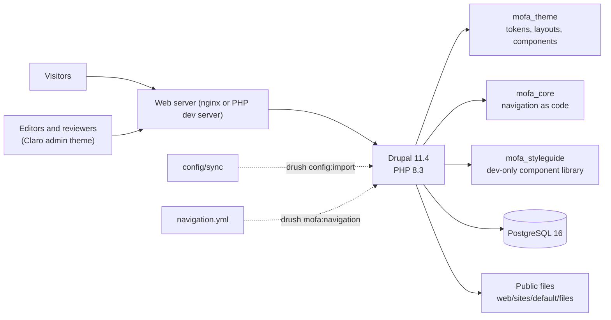

# Architecture

This document describes the Phase 1 foundation. Decisions are recorded in
[docs/adr](adr/).

## Overview

## Building blocks

| Layer | Choice | Why |
| --- | --- | --- |
| CMS | Drupal 11.4 (core only, plus Drush) | Maintained, supported, strong editorial and multilingual features. See ADR 0001 and 0003. |
| Database | PostgreSQL 16 | Specified by the project; required version for Drupal 11. |
| Configuration | Drupal config management in `config/sync` | Every environment is built the same way and changes are reviewable. ADR 0002. |
| Theme | Custom theme, no base theme, single-directory components | Full control of markup for accessibility; components are reusable and documented. ADR 0004. |
| Editorial workflow | Core Content Moderation | Draft, review, approval and publication with revision history. ADR 0005. |
| Languages | Core Language and Content Translation, English only | Arabic can be added later without restructuring. ADR 0006. |
| Navigation | `navigation.yml` built by a Drush command | Menus are content in Drupal; keeping them in code makes the IA reviewable. ADR 0009. |

## Content model

See [content-model.md](content-model.md). Every content type carries the same
editorial fields: an "Unverified placeholder content" flag (on by default),
sources, internal source notes, last-reviewed date and content owner.

## Security posture of this phase

- No forms collect personal information. There is no registration content
  type or form module.
- Visitors cannot create accounts (`user.settings:register = admin_only`).
- Editorial roles have no site-administration permissions; publishing is
  separated from authoring and reviewing.
- Settings read secrets from the environment; nothing secret is committed.
- No third-party requests: fonts are self-hosted and there is no analytics.
- Every page sends `noindex, nofollow`.

## Diaspora registration (not in scope)

Registration is not authorized in Phases 1 and 2. The architecture review
recommended building it, when authorized, as a separately protected service
with its own database, encryption keys and staff access, rather than inside
this Drupal site. See ADR 0010. Phase 2 will only add an informational page
and an inactive, clearly labelled entry point.
